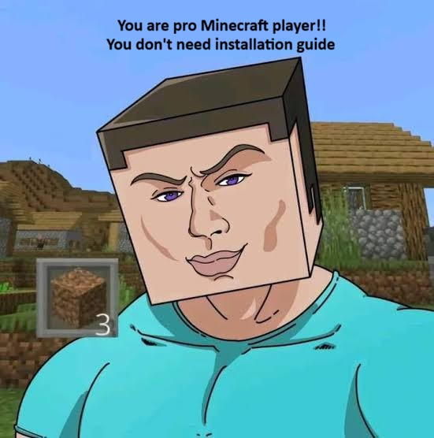

<!-- Put your image in an "images" folder in the repo and name it screenshot.png (or change the path below) -->


# Bridge Practice

A Fabric mod for Minecraft **26.3** that gives you a tiny void world to practice **speed bridging**.

There are two small islands floating in the void. Bridge from island **A** to island **B**, drop into the well in the middle of island B, and the run is complete. Then it all repeats. You can move island B anywhere you like to practice different distances, heights and angles.

---

## Features

- Two small islands in an otherwise empty void
- Island B can be moved to any position with a command
- Falling off sends you back to island A and clears the blocks you placed
- Finishing a run gives you a "Completed!" message and fireworks, then resets you automatically
- Island B's position is saved and only ever changes through commands

---

## Commands

| Command | Description |
|---|---|
| `/bridge start` | Builds both islands, teleports you onto island A facing island B, and fills your inventory with blocks. |
| `/bridge stop` | Leaves practice mode and removes the blocks you placed. |
| `/position <x> <y> <z>` | Moves island B to the given coordinates. Supports `~` relative coordinates. |
| `/position reset` | Puts island B back at its default position. |

### `/position` details

- The coordinates are the **centre of the top layer** of island B (the well is centred on your X and Z).
- The default position is `0 100 20`.
- Y must be between `-40` and `300`.
- Island B can't be placed overlapping island A (island A is at `0 100 0`).
- Moving island B clears your current bridge and sends you back to island A.
- Falling, completing a run, or restarting **never** changes island B's position. Only `/position` and `/position reset` do.

Examples:

```
/position 0 100 30        # 30 blocks straight ahead
/position 10 100 25       # slightly to the side
/position 0 110 20        # higher than island A
/position 0 90 20         # lower than island A
/position reset           # back to default
```

---

## How a run works

1. Run `/bridge start`. You spawn on island A (green emerald) facing island B (gold).
2. Bridge across to island B.
3. Jump into the **3x3 well** in the middle of island B to complete the run.
4. You get **"Completed!"**, you are teleported high above island A, and fireworks launch for about 5 seconds.
5. After the delay, your bridge is removed and you are back on island A, ready for the next run.
6. If you fall into the void at any point, you are sent straight back to island A and your bridge is cleared.

---


## Requirements

- Minecraft **26.3**
- [Fabric Loader](https://fabricmc.net/use/installer/) for 26.3
- [Fabric API](https://modrinth.com/mod/fabric-api) for 26.3
- Java 25

## Recommended world setup

1. Create a new world in **Survival** mode.
2. Set World Type to **Superflat**, click **Customize**, and choose the **The Void** preset.
3. Join the world and run `/bridge start`.

Survival mode is recommended. Creative lets you fly and Adventure mode stops you placing blocks.

---
